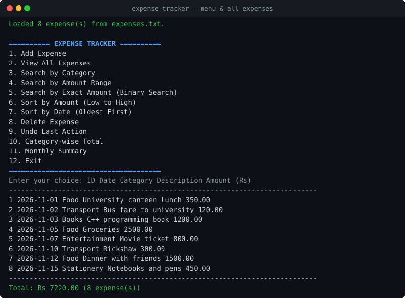
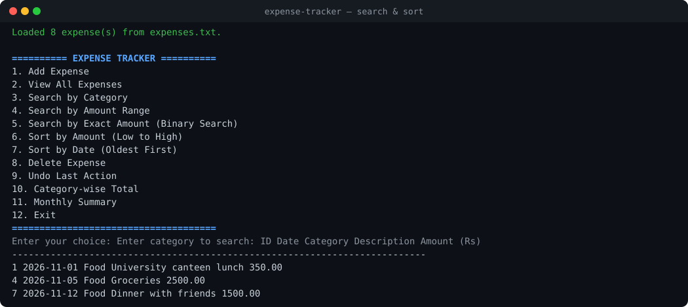
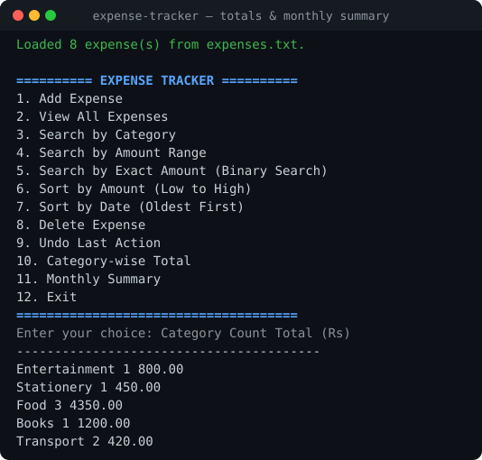
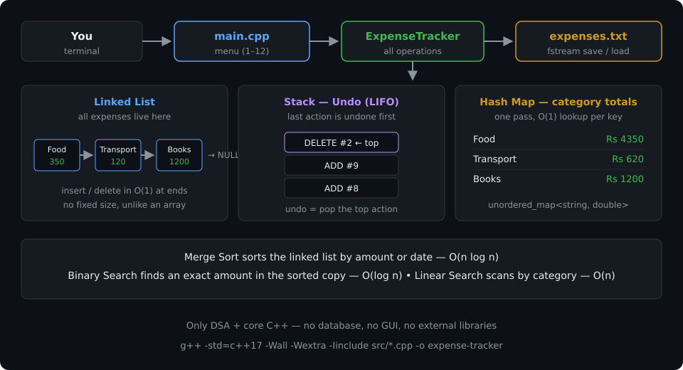

# Expense Tracker — C++ (DSA Project)


A menu-driven console app to record daily expenses and analyse them.
Built with **only Data Structures & Algorithms concepts in C++** —
no database, no GUI, no external libraries.

## Screenshots

### Main menu & all expenses



### Search & sort



### Category totals & monthly summary



## How it works



1. **You** pick an option from the menu in `main.cpp` (1–12).
2. **ExpenseTracker** runs the operation.
3. All expenses live in a **singly linked list** — new records are added at
   the end, deleted ones are removed by id. No fixed size, unlike an array.
4. **Undo** is a **stack (LIFO)**: every add/delete pushes an action, undo
   pops the last one and reverses it.
5. **Category totals** use **hashing** (`unordered_map`): one pass over the
   data, O(1) average lookup per category.
6. **Merge sort** sorts the linked list by amount or date — O(n log n).
   **Binary search** finds an exact amount in a sorted copy — O(log n).
   **Linear search** scans by category or amount range — O(n).
7. After every change, data is saved to `expenses.txt` with `fstream`
   (core C++), and loaded again at startup — so nothing is lost.

## Features

| # | Feature | DSA concept behind it |
|---|---------|----------------------|
| 1 | Add / view / delete expenses | Singly Linked List (dynamic storage) |
| 2 | Sort by amount or date | Merge Sort on the linked list — O(n log n) |
| 3 | Search by category / amount range | Linear Search — O(n) |
| 4 | Search by exact amount | Binary Search on a sorted copy — O(log n) |
| 5 | Undo last add / delete | Stack (LIFO) |
| 6 | Category-wise totals | Hashing (`unordered_map`) — O(1) average |
| 7 | Monthly summary | Linear scan with a date prefix |
| 8 | Data saved to `expenses.txt` | File handling (`fstream`, core C++) |

## Project structure

```
expense-tracker/
├── include/
│   ├── Expense.h          # Expense record + linked-list Node
│   ├── ExpenseList.h      # Linked list + merge sort (declaration)
│   ├── ExpenseTracker.h   # Tracker: undo stack, search, totals
│   └── FileHandler.h      # Save / load (declaration)
├── src/
│   ├── ExpenseList.cpp    # Linked list + merge sort (implementation)
│   ├── ExpenseTracker.cpp # Undo, binary search, hashing totals
│   ├── FileHandler.cpp    # fstream save / load
│   └── main.cpp           # Menu + input handling
├── images/
│   ├── menu-view.svg      # Screenshot: menu & expense table
│   ├── search-sort.svg    # Screenshot: search & sort
│   ├── totals.svg         # Screenshot: totals & monthly summary
│   └── how-it-works.svg   # Diagram: how the program works
├── expenses.txt           # Saved data (created on first save)
└── README.md
```

## How to compile & run

```bash
g++ -std=c++17 -Wall -Wextra -Iinclude src/*.cpp -o expense-tracker
./expense-tracker
```

Requires only a C++17 compiler (g++ / MinGW / Clang). No setup, no dependencies.

## How data is stored

One expense per line in `expenses.txt`, fields separated by `|`:

```
3|2026-11-03|Books|C++ programming book|1200
```

## What I learned

- Why a linked list fits records that grow and shrink (no fixed size like an array)
- Merge sort on a linked list (slow/fast pointer split + merge)
- When linear search is right (unsorted data) and when binary search is right (sorted data)
- Stack for undo, hashing for fast category totals
- Splitting a program into headers + source files

## Future ideas

- Edit an existing expense
- Budget limit per category with a warning
- Export monthly report to a file
- Doubly linked list for backward traversal
